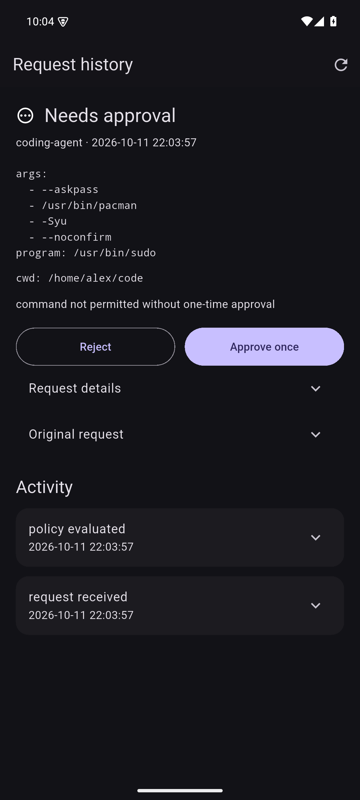
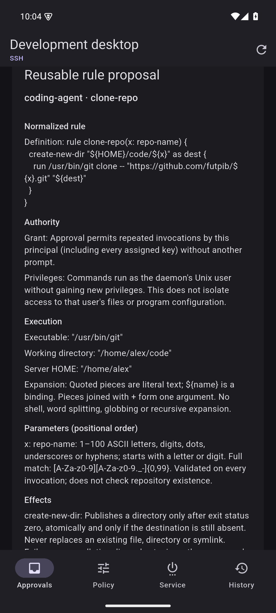
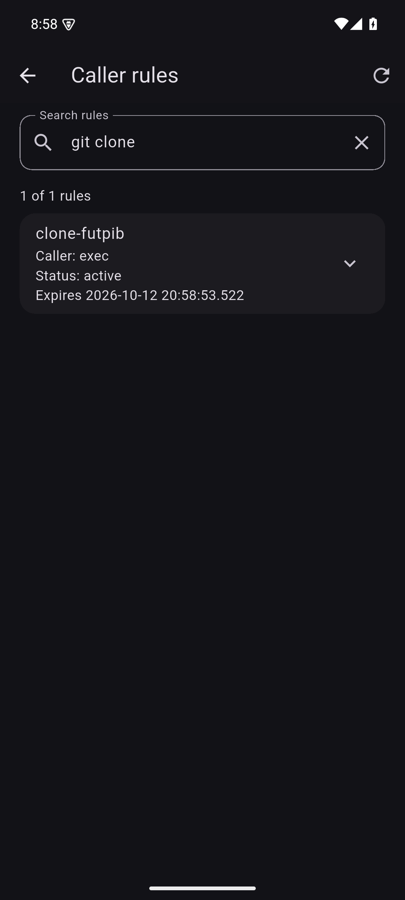

# zond

Let AI agents work on your Linux machines with permissions you control.

An agent can request a command or propose a reusable rule. Review it from
the zond Android app or CLI, then approve one execution, grant temporary
permission, or allow the rule until revoked.

## Screenshots

<table><tr>
<td></td>
<td></td>
<td></td>
</tr></table>

## How it works

1. Give the agent a dedicated SSH key restricted to the zond bridge.
2. The agent submits commands or proposes rules using `zondctl`.
3. Review the resolved command, parameters, working directory, and requested
   privileges before approving.
4. Inspect results and history, follow background jobs, and cancel work
   when needed.

The default policy requires approval for every valid command request.
Reusable rules let you authorize repeat tasks with defined parameter
constraints. Revocation prevents future invocations; running jobs can be
cancelled separately.

zond uses your existing OpenSSH server, optionally reached through
iroh-ssh. `zondd` is the receiving daemon, `zondctl` is the CLI, and zond
is the Android controller.

Commands execute with the receiving Unix account's authority. zond
controls command authorization; it does not provide a filesystem or
network sandbox.

[](https://apps.obtainium.imranr.dev/redirect?r=obtainium://add/https://github.com/futpib/zondd)

The zond Android controller's [Obtainium setup and release instructions](android-app/README.md#obtainium-and-apk-downloads)
cover installation and updates. Downloads become available after the first Android release is published.

```text
zondctl → ssh [→ iroh-ssh proxy] → sshd → zondd bridge
                                              ↓ principal Unix socket
                                         zondd serve → command as the same user
                                              ↑ separate admin Unix socket
                                         zondctl review
```

## Configure the receiver

On Arch Linux, install the [`zondd-git`](https://aur.archlinux.org/packages/zondd-git)
package from the AUR:

```sh
yay -S zondd-git
```

The package installs `zondd` and `zondctl` in `/usr/bin`, the systemd user
service in `/usr/lib/systemd/user`, and the example policy in
`/usr/share/doc/zondd`. To check the configuration and start the user service:

```sh
zondd check
systemctl --user daemon-reload
systemctl --user enable --now zondd.service
```

The package service uses `/usr/bin/zondd serve`. If migrating from a Cargo
installation, remove your old `~/.config/systemd/user/zondd.service` copy so
it no longer overrides the packaged unit, then reload the user manager and
restart the service. Keep any intentional local customizations as drop-ins.

For a Cargo installation, install the binaries and
[zondd.service](zondd.service) as a **user service**:

```sh
cargo install --locked --path zondd
cargo install --locked --path zondctl
mkdir -p ~/.config/systemd/user
cp zondd.service ~/.config/systemd/user/zondd.service
zondd check
systemctl --user daemon-reload
systemctl --user enable --now zondd.service
```

No policy file is required. Without one, the built-in `default` principal
accepts command requests with **nothing automatically allowed**: every valid
command waits for one-time approval, expires after five minutes, and runs in
the user's home directory only after approval. No named operations are enabled.
The daemon creates its private history storage, but does not create a policy file.

Approvals are enabled by default. Setting `[approvals] enabled = false` makes
`ask` requests reject immediately; explicit `allow` rules still run and explicit
`deny` rules remain hard denials. It never enables unrestricted SSH access.

A policy file is optional customization. The Android policy editor shows editable
built-in settings when the file is missing; saving creates the file. An omitted
`principals` section uses the built-in principal. Explicit principal tables replace
it, and `[principals]` with no entries disables every caller. Existing explicit
principals retain their default-deny behavior unless `default = "ask"` is set.
Malformed, unreadable, or untrusted files cause errors instead of falling back.
For a richer example, see [config.example.toml](config.example.toml).

The unit runs `%h/.cargo/bin/zondd serve`, installs into `default.target`, and
uses a private runtime directory. To run in the foreground, use `zondd serve`.
Config defaults to `$XDG_CONFIG_HOME/zondd/config.toml` (normally
`~/.config/zondd/config.toml`); sockets default to `$XDG_RUNTIME_DIR/zondd`.
When an SSH session lacks `XDG_RUNTIME_DIR`, the bridge uses `/run/user/<uid>/zondd`
if available, otherwise a private `zondd-<uid>` directory in the temporary
directory. The daemon and CLI use the same resolution. `--config`,
`--runtime-dir`, and the config's optional `runtime_dir` support explicit paths.

Daemon, execution, and approval all use the same Unix account. There are no
`admin_uid`, `bridge_uid`, `run_uid`, or `run_gid` settings; remove these fields
from older configurations. Commands inherit the daemon's UID, GID, and groups.
Config and its ancestors must be owned by that user or root and protected from
other users' writes. The runtime directory belongs to the daemon user (0700),
and sockets are owner-only (0600); trusted paths reject symlinks.

Enroll a caller public key on the receiver, as the daemon's Unix user:

```sh
zondctl authorize-key /path/to/caller.pub
# Or paste the complete public key as a single quoted argument, without a file:
zondctl authorize-key 'ssh-ed25519 AAAA... caller@example'
# To select a principal already defined in a custom policy:
zondctl authorize-key /path/to/caller.pub --principal automation
```

The helper validates the key with `ssh-keygen`, prints a unified diff of
`~/.ssh/authorized_keys`, and asks **Apply this authorized_keys change? [y/N]**.
It requires an interactive terminal; through SSH, use a normal login with `ssh -t`.
Declining leaves the target untouched. Acceptance atomically installs a restricted
forced-command entry; sshd needs no restart. Ordinary entries for the same key
are converted, including duplicates. Unrelated keys and comments are preserved.
A key already carrying different SSH options is refused so existing restrictions
are not silently lost. Concurrent changes during review abort the write.

Options include `--authorized-keys PATH`, `--config PATH`, and `--zondd /absolute/path`.
The binary defaults to `zondd` beside the running `zondctl`; the runtime directory
comes from the selected policy/environment. Only authorized_keys is changed;
the selected principal must already exist, or be the built-in `default`.
Enrollment is logged when the daemon is reachable. Keep a separate ordinary SSH
key for management.

For manual installation with the default principal and runtime directory, the
equivalent entry is:

```text
restrict,command="/usr/bin/zondd bridge" ssh-ed25519 AAAA... caller-key
```

Use the installed absolute path to `zondd` on the receiver.
For a custom principal, add `--principal NAME`; for a custom runtime directory,
add `--runtime-dir /absolute/path` to the fixed command. The helper includes
these arguments when needed and quotes paths containing shell metacharacters.
`restrict` disables forwarding, PTYs, agent/X11 forwarding and user
SSH rc execution for that key. The bridge rejects nonempty
`SSH_ORIGINAL_COMMAND`; the caller opens a session without a shell command and
writes protocol frames. Other keys can retain their normal SSH access.

To remove one caller or every zondd bridge entry from the selected
`authorized_keys` file:

```sh
zondctl revoke-key /path/to/caller.pub
zondctl revoke-key 'ssh-ed25519 AAAA... caller@example'
zondctl revoke-key --all
# For a nondefault key file, add --authorized-keys /path/to/authorized_keys.
```

Revocation shows a diff and requires terminal confirmation. It removes only
recognized zondd bridge entries, leaving ordinary SSH keys and other forced
commands untouched. Concurrent file edits abort the change. Revocation affects
new SSH connections; it does not disconnect a session already authenticated.
The daemon records the change when reachable.

The forced command binds the key to a principal socket; the daemon also checks
the local peer UID. The remote protocol cannot select another principal or
invoke approval methods. Local code running as the daemon user has that user's
full authority, including approval. This also applies to programs authorized
to run as that user. Use separate Unix accounts and separate user daemons when
OS-level isolation between users is needed.

## Send operations

Save a connection on the caller machine after enrolling its public key. Use the
receiver's Unix username, address and the matching private key:

```sh
zondctl --host alice@server --identity ~/.ssh/caller connections add work-vm
# For Iroh, supply --iroh and use the endpoint ID as the address:
zondctl --iroh --host alice@<64-hex-endpoint-id> \
  --identity ~/.ssh/caller connections add iroh-vm

zondctl connections
zondctl --host work-vm context
zondctl --host work-vm permissions
zondctl --host work-vm exec /usr/bin/uptime
```

`connections add` prints ready-to-run commands. Each named connection is an
ordinary OpenSSH config in `$XDG_CONFIG_HOME/zondctl/connections/NAME.conf`
(normally `~/.config/zondctl/connections/NAME.conf`). It remembers the receiver,
username, key path, port and Iroh transport; it never copies a private key.
Explicit `--port` and `--identity` still work. An explicit `--ssh-config`
selects that file instead of the saved connection. Remove a local connection
with `zondctl connections remove NAME`; use `revoke-key` on the receiver to
revoke access.

`context` resolves SSH settings without connecting and shows the receiver,
transport, candidate identities and role. `permissions` verifies the
authenticated principal and its policy on the receiver. With no `--host`,
zondctl selects a **local** Unix socket: the admin socket by default, or a caller
socket with `--principal`. It never automatically selects a saved receiver.

You can also supply the connection settings on every command:

```sh
zondctl --host alice@server --identity ~/.ssh/caller exec /usr/bin/uptime
# With the built-in policy this waits for approval; review with zondctl review.
zondctl --host alice@server --identity ~/.ssh/monitor operations
zondctl --host alice@server --identity ~/.ssh/monitor invoke service-status slopd.service
```

`--port` and `--ssh-config` select an alternate sshd port or SSH configuration.
Normal host-key verification applies. The client disables PTYs, forwarding,
connection sharing and configured remote commands for its own session.

For an existing Iroh SSH server forwarding to sshd:

```sh
zondctl --iroh --host alice@<64-hex-endpoint-id> \
  --identity ~/.ssh/monitor invoke service-status slopd.service
```

This runs OpenSSH with `ProxyCommand=iroh-ssh proxy %h`. For a custom Iroh proxy
configuration, put it in your SSH config and use `--host` without `--iroh`.

Local callers select the same policy principal without SSH:

```sh
zondctl --principal automation exec /usr/bin/uptime
zondctl --principal monitor invoke service-status slopd.service
# An explicit --socket /path/to/PRINCIPAL.sock also works.
```

`exec` and `invoke` return the command result when it finishes within
`command_timeout_secs`. If execution runs past that deadline, the command keeps
running under the daemon and the CLI automatically follows its retained and live
output until completion. Both `exec` and `invoke` exit with the command's result,
including in `--json` mode. There is no need to restart the command.

Human-readable lifecycle notices go to stderr: the selected receiver, a pending
request's principal and approval expiry, an exact command to inspect it, and the
final exit code or signal. Command stdout remains suitable for pipes. Use
`--quiet` before the subcommand to suppress notices while retaining command
stderr and errors, or `--json` for protocol events without human-readable notices.

`request REQUEST_ID` shows your principal's request and its action history;
`job REQUEST_ID` shows its current or final state. On older receivers that
require admin access for `request`, the CLI suggests the equivalent `job` command.
Commands marked **admin only** in `--help`, such as `pending`, `status`, `history`
and `approve`, require the receiver's local admin socket or the Zond controller.
The restricted caller key cannot perform administrative actions.

Use `--detach` before the program or operation name to return the job ID when
the command moves to the background. It still waits for approval and the daemon's
execution deadline; commands finishing before that deadline return their result
normally. A detached submission exits with zero to acknowledge the job, not its
eventual result. Use the same caller key or principal to inspect, follow, or
cancel it afterward.

```sh
zondctl --host alice@server --identity ~/.ssh/caller exec /usr/bin/long-command --flag
zondctl --host alice@server --identity ~/.ssh/caller exec --cwd /var/tmp /usr/bin/pwd
zondctl --host alice@server --identity ~/.ssh/caller exec --detach /usr/bin/long-command --flag
zondctl --host alice@server --identity ~/.ssh/caller invoke --detach system-upgrade
zondctl --host alice@server --identity ~/.ssh/caller follow REQUEST_ID
zondctl --host alice@server --identity ~/.ssh/caller job REQUEST_ID
zondctl --host alice@server --identity ~/.ssh/caller cancel REQUEST_ID
# Named operations use invoke OPERATION [ARGS...] the same way.
```

`follow` streams retained output first, then live stdout and stderr, and exits
with the job's result. It may be disconnected and restarted; `--after SEQUENCE`
resumes after an output chunk sequence from `--json` mode. Automatic following
also emits the `submitted`, output and final job events in JSON mode. Once
following, Ctrl-C exits the CLI with status 130 and leaves the job running;
use `cancel` to stop it. A gap event warns
when earlier output has been discarded. `cancel` kills the job's process group.
Once a command moves to the background, it has no wall-time timeout and
`max_output_bytes` becomes a per-job output retention cap. Before that point,
disconnect cancels the command and exceeding the output limit kills it.
`max_running` still limits concurrent processes. Backgrounded output and status
survive caller disconnects, but stopping the daemon interrupts running jobs.
Commands still have null stdin and no PTY, so programs that need interactive
input cannot run this way.

## Apply policy changes

After editing the config, run `zondctl reload` as the daemon user. It waits for
validation and reports the applied revision or an error. The Android app's
**Save & apply** does the same over ordinary SSH or SSH through Iroh.
`systemctl --user reload zondd` sends SIGHUP; check the journal for its result.

Reload reads the original startup config path, validates it, and prepares any
new principal sockets before atomically replacing the active policy. Invalid
configurations, untrusted files, and socket conflicts leave the active policy
and approval queue intact. Rules, operations, principals, approval settings,
and limits take effect without restarting. Changing `runtime_dir` requires a
restart. `zondctl status` includes the active config's SHA-256 revision.

Commands already admitted keep running with their original policy and limits.
Reload re-evaluates waiting requests without disconnecting their callers:

- Requests that still need approval keep their approval ID and original expiry.
- Newly allowed requests execute using the new policy and limits, waiting for
  capacity if necessary. Their original expiry still applies.
- Newly denied requests, removed principals/operations, and requests needing
  disabled approvals are rejected with the specific reason.
- A changed executable, argv, or working directory requires fresh review, even
  if the new rule allows it. The caller receives another `pending` event with a
  new approval ID and the same request ID/deadline. Old approvals cannot apply.

Reload, review decisions, and execution admission share the same lock. A denial
can supersede an approval that is still waiting for capacity. Lower limits do
not kill admitted commands. Removing a principal closes its listening socket
while existing callers receive their outcomes. Reload requires admin authority.

## Inspect caller permissions

Use the same caller key or local principal that will submit the operation:

```sh
zondctl --host alice@server --identity ~/.ssh/caller permissions
zondctl --host alice@server --identity ~/.ssh/caller check exec /usr/bin/uptime
zondctl --host alice@server --identity ~/.ssh/caller check exec --cwd /var/tmp /usr/bin/pwd
zondctl --principal monitor check invoke service-status slopd.service
zondctl --principal default --json check exec /usr/bin/id -u
```

These commands also work with `--iroh`. `permissions` returns only the
authenticated principal's policy: its working directory, `allow_exec`, default
decision, ordered command rules, and assigned named operations with executable,
fixed arguments, argument choices, and decisions. It also includes the active
policy revision, approval settings, and execution limits. Other principals and
unassigned operations are not exposed. Rules are first-match-wins; `args: null`
matches any arguments, while `args: []` matches no arguments. If `allow_exec` is
false, raw commands are denied regardless of rules. Operation decisions are
independent of raw-command rules.

`check exec` and `check invoke` use the execution policy evaluator, without
executing, creating request history, or adding an approval request. The daemon
still audits the query. The response includes `decision` (`allow`, `ask`, or
`deny`), `policy_decision`, a reason, the resolved command when valid, working
directory, and policy revision. With approvals disabled, a configured `ask`
produces effective `deny`; malformed commands and unauthorized operations also
produce `deny`. A successful check returns CLI exit status 0 for all three
decisions; use `--json` and inspect `check.decision` in scripts.

Checks describe the current policy, not a reservation or an execution guarantee.
Submission evaluates the policy again; queue capacity, executable availability,
and runtime failures are not tested. With no policy file, the built-in `default`
principal reports `ask` for valid commands. Local use requires `--principal`
or a principal `--socket`; the admin endpoint has no caller identity.

## Propose reusable typed rules

A caller can propose a small declarative rule for administrator review. Save this
as `clone-futpib.zond` on the caller:

```text
rule clone-futpib(x: repo-name) {
  require is-dir "$HOME/code"
  create-new-dir "$HOME/code/$x" as dest {
    run git clone -- "https://github.com/futpib/$x.git" "$dest"
  }
}
```

Submit, observe, check, and invoke through the same authenticated connection:

```sh
zondctl --host alice@server --identity ~/.ssh/caller propose-rule --file clone-futpib.zond
zondctl --host alice@server --identity ~/.ssh/caller rules
zondctl --host alice@server --identity ~/.ssh/caller check invoke clone-futpib zondd
zondctl --host alice@server --identity ~/.ssh/caller invoke clone-futpib zondd
zondctl --host alice@server --identity ~/.ssh/caller withdraw PROPOSAL_ID
```

Inline proposals also work as one quoted argument; preserve `$variables` from
expansion by the caller's shell:

```sh
zondctl --principal default propose-rule 'rule echo-repo(x: repo-name) { run printf "%s" "$x" }'
```

`propose-rule` returns the immutable proposal ID, digest, original source, and
resolved definition, then disconnects. Nothing executes or becomes allowed until
the administrator approves. `rules` and `permissions` expose the authenticated
principal's definitions, parameter types, checks, destination templates, status,
reason, and expiry. They include every live rule plus recent terminal proposals,
up to 256 records, with live rules first. Other principals' proposals and rules
are hidden. `check invoke` shows the resolved argv and destination and checks
current filesystem preconditions without creating anything. Invalid parameters
produce an explanation before any executable starts.
The rules response has its own revision; `permissions` and `check` return
`rules_revision` alongside the existing config revision, so callers can detect
grant changes even when TOML is unchanged.

Callers can use `zondctl withdraw ID` with their own command request ID or rule
proposal ID. Pending rules leave the approval queue, and approved rules lose
permission for future invocations. Both remain visible with status `withdrawn`;
the rule name can then be proposed again. Already admitted invocations continue
unless their command request is withdrawn separately. Commands awaiting approval,
waiting for capacity, or running (including background jobs) are cancelled using
the existing process-group cleanup. Completed work cannot be undone or withdrawn.

Withdrawal is scoped to the authenticated principal, including its other assigned
keys, and never deletes history. The original command or rule source, compiled
definition, review, digest and prior approval records remain available. The daemon
records withdrawal intent and commits the state change and timestamped audit event
before removing authority or cancelling work. If that write fails, withdrawal
fails without changing the submission. Administrators can inspect `rule_withdrawn`
and `request_withdrawn` in `zondctl actions`; command details also retain the event.

On the receiving host, `zondctl review` and the Android approval screen display
rule proposals separately from one-time command requests. Review includes the
full source, actual executable, receiver's HOME, working directory, principal,
and parameter constraints. Choose an expiring grant or approval until revoked.
For scripting, use the digest from the reviewed proposal:

```sh
zondctl pending
zondctl approve-rule PROPOSAL_ID --digest DIGEST --for-secs 3600
# Alternatively choose --permanent instead of --for-secs.
zondctl deny-rule PROPOSAL_ID --digest DIGEST
zondctl rules
zondctl revoke-rule PROPOSAL_ID
```

Each proposal includes a receiver-generated `review` document, covered by the
same immutable digest as its source and resolved definition. Review format 1
contains `version`, a plain-text `title`, and ordered `sections`; each section
has a `title` and `fields` containing plain-text `label` and `value` strings.
The receiver describes parameter constraints, checks, effects, authority and
execution bindings. Clients render every section and field without interpreting
the rule language or maintaining a list of type/check/effect names. New language
constructs using this format need no Android update. The CLI also sends proposal
source to the receiver for parsing, without requiring a matching local parser.

The caller submits source only; additional compiled-definition or review fields
are rejected. The receiver generates a normalized rule from the exact compiled
definition it executes, including the resolved executable and explicit variable
boundaries. Android uses that daemon-generated review as the main approval display;
the caller's original spelling and comments remain in **Rule details (YAML)** and
audit history. The Android client does not parse or regenerate the rule language.

Before restoring saved proposals and grants, the daemon re-parses their original
source, resolves the executable, compares the resulting definition and HOME binding,
and verifies the proposal digest. Policy refresh also verifies the bound working
directory. Inconsistent records are invalidated with an audit entry and cannot
be approved or invoked. This detects inconsistent persistence; it does not protect
against a compromised daemon or an administrator who controls its database and code.
Valid older reviews without the normalized rendering remain usable.

New rendering semantics can use a new review format version. When Android does
not recognize a review's format or fields, or the review document is missing,
it displays the complete proposal JSON as YAML directly in the approval card.
Approval, lifetime selection, rejection and revocation remain available. Known
formats also offer the complete YAML under **Rule details (YAML)**. This fallback
preserves every field and scalar type, including nested future definitions;
quoted strings make control characters visible. Approval still submits the
exact proposal ID and digest supplied by the receiver.

Saved proposals and grants whose review is missing or differs from the current
receiver's description are invalidated and require a new proposal and approval;
unchanged reviews survive restarts. Historical definitions remain visible.

The Android **Caller rules** screen also lists definitions and supports
revocation. Approval grants repeated invocations to the proposing **principal**,
including all SSH keys assigned to it. Use different principals for separate
grants. The caller cannot approve, revoke, change the principal, or broaden an
approved definition. Replacing a rule requires revoking it and reviewing a new
proposal; a changed digest cannot reuse an approval. These rules are invoked by
name and do not add raw `exec` allowlist entries. Commands retain `no_new_privs`
unless the proposed definition explicitly uses `run --sudo PROGRAM ...`.
That flag enables sudo password challenges and permits privilege escalation by
child processes, subject to sudoers. The receiver describes this authority in
the review and includes it in the approval digest. It does not run the program
as root or store passwords. Existing grants keep their original privileges.

The language supports one `run`, optional `require is-dir`, `require absent` and
`require user-service-active-or-enabled` checks before it, and an optional
`create-new-dir PATH as VARIABLE { ... }` block.
`create-new` remains an alias for older rule source.
Each check occupies its own line. Parameters are positional and declared as
`name: repo-name`; up to 16 are allowed. `repo-name` requires a full match of
`[A-Za-z0-9][A-Za-z0-9._-]{0,99}`: bounded ASCII, no slash, leading hyphen,
whitespace, control characters, or Unicode. It validates syntax, not remote
repository existence. Every invocation is checked on the receiver, including
requests made directly through the protocol.

Double quotes group arguments and allow `$name` or `${name}` substitution;
single quotes preserve literal text. Backslash can quote a backslash, quote,
dollar sign or space. Expansion happens exactly once into argv entries, with no
shell, word splitting, command substitution, globbing, pipelines, or redirection.
`$HOME` is the receiving daemon's home, frozen at proposal time. Bare executable
names resolve through `/usr/bin:/bin` when proposed; review and execution use
the resulting absolute path. A rule cannot substitute its executable.

For a trusted user service, allow restarting it while active, or starting it
while enabled:

```text
rule restart-my-app() {
  require user-service-active-or-enabled "my-app.service"
  run systemctl --user restart -- "my-app.service"
}
```

The check queries the daemon user's systemd manager using `/usr/bin/systemctl`.
It requires `LoadState=loaded` and either `ActiveState=active` or
`UnitFileState=enabled`/`enabled-runtime`. A stopped or failed disabled service
does not pass; request a separate one-time command approval to start it.
Stopping an enabled service manually leaves it enabled, so it still passes.
`static`, `indirect`, `generated` and `transient` do not count as enabled;
`systemctl is-enabled`'s exit status is deliberately not used.

The target is one explicit `.service` name, up to 255 ASCII characters, starting
with a letter or digit and containing only letters, digits, dots, underscores,
hyphens and optionally one `@` with a nonempty instance. Paths, glob patterns,
options and bare templates are rejected. Substitution works here too, for example
`"my-app-$x.service"` with `x: repo-name`. Review the permitted names and the full
`run` command together; a state check does not select or restrict its arguments.
Services launched through systemd use their own unit settings and do not inherit
the command's `no_new_privs` restriction.

`check invoke` previews service checks, and invocation checks again after obtaining
execution capacity. A missing unit, unavailable manager, malformed response or
query failure prevents execution. Service queries share a five-second deadline.
Service state can change between checking and running the command; this is an
observed precondition, not an atomic conditional systemd operation.

`require` checks run again immediately before execution. They observe state at
that moment; another process can change it afterward. Use `create-new-dir` for the
stronger directory-publication guarantee. It requires an absent destination
(including no dangling symlink), creates private staging on the same filesystem,
and binds the output variable to a staging path. On exit status zero, the command
must have produced a directory. Zondd publishes it using atomic
`RENAME_NOREPLACE`; any destination created meanwhile causes failure without
replacement. There is no unsafe fallback on filesystems lacking this operation.
Failures and cancellations clean up staging without publishing partial output.
Parent directories must already exist, be trusted, and contain no symlinks.

As with ordinary commands, this is not filesystem isolation: the approved
executable runs as the daemon's Unix user, can access that user's other files,
and follows its own program configuration. For example, Git can honor URL
rewrites in its configuration. `create-new-dir` protects the publication performed
by zondd; it does not sandbox arbitrary writes performed by an approved program.
Review the full command and use a separate Unix account for isolation.

Grants and proposal outcomes live in the daemon's private history database;
hand-edited TOML is unchanged. Live proposals and approved grants survive daemon
restarts. Proposals expire using the approval timeout, and grants may expire
after 1 second to 365 days or persist until revoked. Changes to the config
invalidate pending proposals. Changes to the granting principal or a collision
with a configured operation invalidate its grants; unrelated config changes
preserve them. Revocation and expiry prevent new admissions, leaving already
admitted jobs running. All transitions and the grant used by each invocation
are recorded in the audit history. There are at most 64 pending proposals and
128 active grants, and each compiled proposal is limited to 12 KiB.

## Policy and approval

Raw `exec` requires `allow_exec = true`. Rules match the literal absolute
program path and, when `args` is present, the complete argv vector. A rule
without `cwd` matches only the principal's configured working directory.
`exec --cwd /absolute/path` requests another directory; it is denied unless a
rule for that command names the exact directory with `cwd = "/absolute/path"`.
The principal's default decision applies only in its configured directory.
`check exec --cwd` previews the same decision. Rules are
ordered; the first match wins. Omitting `args` permits the rule to match every
argument vector for that program. No shell quoting, glob, regex, path
canonicalization, or command-prefix matching is performed. Directory matching
controls where a command starts; it does not restrict which files the command
can access. Requested directories must be absolute and cannot contain `.` or
`..` components. Named operations continue to use the principal's configured
directory.

`allow` executes immediately; `deny` rejects immediately; `ask` blocks pending
one-time review when approvals are enabled, otherwise it rejects. Set
`default = "ask"` to queue commands that lack an allow/deny rule. A hard denial
cannot be overridden by approval. Approvals are enabled by default.

Operation-only principals have `allow_exec = false` and a list of allowed
operation names. Each operation fixes the executable and leading arguments;
the caller supplies exactly one value for each positional `arguments` entry,
chosen from that entry's explicit `choices`. Operation decisions are separate
from raw-exec rules. These configured operations do not expand templates;
caller-proposed rules use the separate language above. Neither uses an implicit
shell.

An approved raw `exec` can use `sudo` without a TTY. The one-time approval
permits password challenges and runs the exact approved command without
`no_new_privs`; raw commands allowed without review and ordinary operations
retain `no_new_privs`. The approver sees this privilege capability before
accepting. A named operation can opt in to the same behavior with
`sudo_password = true`; this requires `decision = "ask"` and enabled approvals.
Any setuid helper launched by an approved command can gain privilege, so
review the executable and its child processes. Reload systemd's unit and
restart the bundled user service after upgrading so its former service-level
`NoNewPrivileges` setting is removed:

```sh
systemctl --user daemon-reload
systemctl --user restart zondd
```

Tell sudo to use askpass (`sudo -A`, or `--sudoflags=-A` for `paru`). With the
default policy, submit an upgrade as a raw command and approve that request:

```sh
zondctl exec /usr/bin/paru -Syu --noconfirm --skipreview --noupgrademenu --sudoflags=-A
```

To approve repeated repository and AUR upgrades, save this as `system-upgrade.zond`:

```sh
rule system-upgrade() {
  run --sudo /usr/bin/paru -Syu --devel --noconfirm --skipreview --noupgrademenu --sudoflags=-A
}
```

Submit it with `zondctl propose-rule --file system-upgrade.zond`, then choose
**Until revoked** when approving the rule in Android. The caller can subsequently
use `zondctl invoke system-upgrade` without another command approval. Sudo may
still ask for a password. The executable and all arguments are fixed; the
caller cannot add flags or package names. The grant also authorizes future AUR
build scripts and package hooks run by these upgrades, so review that ongoing
authority before accepting. A daemon supporting `run --sudo` is required;
older daemons reject the proposal.

For a fixed allowlist entry, assign this operation to a principal whose key
you trust to request system upgrades:

```toml
[principals.upgrade]
cwd = "/home/your-user"
operations = ["system-upgrade"]

[operations.system-upgrade]
program = "/usr/bin/paru"
fixed_args = ["-Syu", "--noconfirm", "--skipreview", "--noupgrademenu", "--sudoflags=-A"]
decision = "ask"
sudo_password = true
```

The caller invokes `system-upgrade` or submits raw `exec`, and a local admin
approves the exact request. When sudo needs a password, `zondctl pending` shows
a separate credential challenge. `zondctl credential CHALLENGE_ID` reads the
password without echo, and `zondctl reject-credential CHALLENGE_ID` declines it. `review`
handles both kinds of request. The Android approvals screen also shows a masked
password dialog. Each sudo prompt creates a new challenge, including prompts
after a long backgrounded build. A challenge waits up to 24 hours; cancel the
job to end it sooner. Passwords are sent only over the local admin/control
connection and are excluded from history and daemon logs. Command output is
still retained, so the operation must not print secrets. Package build scripts
run with the user's access and can invoke sudo; review the software sources
before authorizing an unattended AUR upgrade.

On the receiving machine, as the same user who runs the commands (no sudo):

```sh
zondctl pending
zondctl approve <approval-id>
zondctl deny <approval-id>
zondctl credential <challenge-id>
zondctl reject-credential <challenge-id>
zondctl review
zondctl status
```

`review` displays the principal, exact argv, expiry and request ID, with terminal
control characters escaped, and asks for approve/deny/skip/quit. Approval is
bound to that one immutable request, consumed once, and never adds a permanent
allowlist rule. A full queue rejects new requests. Expiry or daemon restart
cancels pending requests; client disconnect cancels attached requests, while
commands that have already moved to the background keep running. Admin
connections have separate capacity so pending remote requests cannot block review.
Restarting or stopping the daemon also cancels active work.

Commands have null stdin, no PTY, and a configured working directory. Their
environment starts with `PATH=/usr/bin:/bin`, `HOME=<cwd>`, and `LANG=C.UTF-8`,
then inherits the daemon's `HOME`, `XDG_RUNTIME_DIR`, `DBUS_SESSION_BUS_ADDRESS`,
`XDG_CONFIG_HOME`, `XDG_DATA_HOME`, and `XDG_CACHE_HOME` when set. This lets user
operations reach their own files and session bus; callers cannot supply environment
variables through the protocol.
While attached, stdout/stderr have a combined byte limit. The CLI reproduces
the retained bytes and the command's exit status when it finishes; rejection
uses 126 and protocol/infrastructure failures use 125. `--json` prints all
protocol events instead. Request bodies and decisions are logged to stderr;
avoid passing secrets in argv if those logs are retained.

## Application credentials

Independently running applications can request missing credentials over the private
local credential API. Systemd owns their lifecycle, jobs and logs; zondd only
brokers authenticated requests, review, private answers and reported outcomes.
Restarting zondd cancels pending input without restarting applications or their
workers. Android and `zondctl review` show configured recipient identity separately
from application-supplied prompts. Answers, including usernames, are excluded
from history and logs.

See the [public protocol, schema, registration and migration guide](adapters/readme.md).
The Rust reference client supports pending input and cancellation. Existing pipe
adapters can use a service-side bridge; the former `credential_adapters` process
supervision and application Retry controls have been removed.

## Request history and action log

The daemon records every execution request, including policy rejections, manual
approvals/denials, expiration, disconnection, execution failures and results.
History retains exact input, resolved executable/argv, working directory,
retained output, exit status and action timestamps. SQLite storage is private
(0600), survives restarts, and is scoped to the config: `config.toml` uses the adjacent
`config.history.sqlite3` database. Its WAL/SHM files belong with that database;
use SQLite backup tooling for a consistent live backup. History is retained
until explicitly removed by the account owner. Background-capable output is
stored in bounded per-request chunks; `follow` reads those chunks. Unfinished
records on startup are marked interrupted; they are never automatically replayed.

```sh
zondctl history --limit 30
zondctl history --query paru --limit 30
zondctl request REQUEST_ID
zondctl retry REQUEST_ID
zondctl actions --limit 50
zondctl actions --query 'approval granted'
zondctl actions --request-id REQUEST_ID
```

History and activity use descending sequence cursors (`--before`) for paging.
The optional `--query` filters stored request summaries or action names/details
before pagination, so it also finds older records. It matches literal substrings
(ASCII case-insensitive); `%` and `_` are ordinary characters. Request searches
include input, command, caller, directory, status and reason, but not retained
stdout/stderr. Keep the same query when following a `next_before` cursor.
The Android **History** tab includes all outcomes, request details, retained output,
approval events, daemon activity and **Run again**. Run again submits the original
structured request as a new request under the same principal's current policy;
operation arguments are validated/expanded again and past approvals never carry
over. Its `retry_of` points to the original. The daemon owns this new request,
so closing the controller does not cancel it. Requests that still need permission
appear in Approvals and can also be reviewed from their history details.

The persistent action log covers lifecycle, requests, policy evaluations,
reloads, reviews, execution and protocol errors. The management helper reports
config/service actions when the daemon is reachable; ordinary external file
edits and actions performed while it is stopped are outside daemon logging.
Actions are also emitted through tracing to stderr/the user service journal.
History, retry and activity are available only on the admin endpoint.

## Android management

[zond for Android](android-app/README.md) connects through a **normal SSH login**
as the daemon user, directly or through your existing iroh-ssh server. Give its
key ordinary SSH access, without a forced caller command. It can review and
approve/reject requests, read/validate/save/apply policy, and start/stop/restart the
systemd user service. SSH host keys are verified on both transports.

The app invokes `zondctl control` through SSH exec. This helper exposes trusted
management on stdin/stdout and talks to the local admin socket; it does not add
another daemon listener or a separate Iroh identity allowlist. It works locally
as well:

```sh
printf '%s\n' '{"version":1,"method":"pending"}' | zondctl control
printf '%s\n' '{"version":1,"method":"pending"}' | ssh alice@server zondctl control
```

One newline-terminated JSON request per process, with `version: 1` and `method`.
Responses are `{ "version": 1, "ok": true, "result": ... }` or
`{ "version": 1, "ok": false, "error": "..." }` (exit 125). The helper exits
without requiring stdin EOF. Methods:

- `pending`, `status`, `resolve` (`approval_id`, `approve`): local admin requests.
- `history` (`before`, `limit`, optional `query`), `request_detail` (`request_id`), `retry`
  (`request_id`), `actions` (`before`, `limit`, optional `request_id` and `query`): history,
  results, resubmission and the persistent action log.
- `read_config`: returns `path`, `content`, SHA-256 `revision`.
- `validate_config` (`content`): parse and validate without saving.
- `save_config` (`content`, `revision`): validate, check the current revision,
  atomically replace with mode 0600. Concurrent helper saves are serialized;
  stale edits fail. External editors do not participate in the helper's lock.
- `reload_config` (`revision`): apply that saved revision through the admin
  socket. Returns `revision` and counts for retained, newly allowed, refreshed,
  and cancelled approvals after applying; stale
  revisions fail. A lost connection can leave the result unknown; check `status`
  before retrying. Reloading the same revision is harmless.
- `service` (`action`: `status`, `start`, `stop`, `restart`): `systemctl --user`
  for `zondd.service`. Restarting applies saved policy and cancels active work.

Control requests are limited to 1 MiB; configuration content to 512 KiB.
`zondctl --runtime-dir PATH control --config FILE` supports custom installations.
Service actions always operate on the installed `zondd.service`; a custom config
path does not change that unit's ExecStart. Reload always reads the daemon's
startup config path and checks the supplied revision. Saving alone leaves the
active policy unchanged until reload or startup. The policy editor works even
when the daemon is stopped.

The management login intentionally retains general-purpose SSH privileges.
Restricted caller keys cannot invoke this helper. Local processes running as
the daemon user already have equivalent authority.

## Security scope

This is authorization for the requested top-level executable and argv. It is
not a shell/interpreter sandbox or a recursive Bash/JavaScript policy engine.
Allowing an interpreter, a writable executable, a script that changes after
review, or an executable with arbitrary command/file-loading options grants
whatever that program can do as the daemon user. A deny rule for `/bin/sh`
does not match another shell path. Prefer named operations with trusted
executables/scripts and explicit argument choices for narrow capabilities.

Commands have `no_new_privs` unless they are approved raw commands or their
approved named operation sets `sudo_password = true`; all have a 077 umask and
disabled core dumps.
There are limits on frame size, connections, queue size, and running commands.
Attached commands have a collected-output limit; disconnect kills their
process group. Exceeding the execution deadline moves them to the background
with bounded retained output. Backgrounded jobs can be cancelled by their owner
or an admin. A deliberately hostile descendant can escape its process group;
there is no per-request cgroup, filesystem or network sandbox.
The supplied systemd user service cleans its entire cgroup on shutdown.
Treat these distinctions as part of configuring
what an approved command is allowed to do.

## Workspace

The workspace follows slopd's shared-library/daemon/client split:

- `libzond`: wire types, bounded framing, policy and operation schemas.
- `libzondctl`: asynchronous Unix-socket and OpenSSH client.
- `zondd`: user daemon and forced-command bridge.
- `zondctl`: sending CLI and local approval interface.
- `libzondtest`: shared isolated process fixtures and a Rust subprocess probe,
  following slopd's `libsloptest` pattern.

## Build and test

```sh
cargo build --workspace --bins
cargo test --workspace
cargo clippy --workspace --all-targets --all-features -- -D warnings
cargo fmt --all --check
```

Named Rust integration tests live in `zondd/tests/integration.rs` and
`zondctl/tests/integration.rs`, with shared fixtures in `libzondtest`.
The normal suite starts real user daemons, tests approval through a PTY,
and verifies that commands retain the user's UID, GID, supplementary groups,
and local approval authority. Run it as your normal user, without sudo.

Additional integration tests have explicit `#[ignore]` reasons because they
require OpenSSH client/server, Iroh connectivity, or a running systemd user
manager. After building the binaries, select them with Cargo:

```sh
# Real OpenSSH transport tests:
cargo test -p zondctl --test integration -- --ignored --skip iroh_ssh --skip trusted_management
# Also exercise the installed Iroh transport and real discovery:
cargo test -p zondctl --test integration -- --ignored
# Start and stop an isolated instance of the shipped systemd user service:
cargo test -p zondd --test integration shipped_user_service -- --ignored
# Independent credential services with systemd-provisioned identities:
cargo test -p zondctl --test credential_api -- --ignored
```

Fixtures create private temporary directories under the user's home (so SSH
StrictModes can remain enabled), ephemeral keys, and isolated loopback sshd
processes running as the current user. Drop guards clean up processes and files
on success and assertion failures, and print logs on failure. The systemd test
uses a uniquely named temporary unit and runtime directory, and removes both.
Tests do not change your installed services or authorized keys. Iroh tests
check pipe EOF after completion to catch orphaned proxy processes.

## Continuous integration and releases

GitHub Actions runs these workflows on pull requests and pushes to `master`:

- **CI**: Rust formatting, Clippy, unit/integration tests, real SSH and key
  enrollment, the systemd user service, and Linux archive builds on x86-64 and
  ARM64; Flutter formatting, analysis and widget tests; workflow and shell linting.
- **Transport and Android E2E**: real Iroh caller/management tests and the Android
  controller tests on an API 35 emulator, including native builds for both app
  architectures. This also runs weekly and can be started manually. It uses
  public Iroh discovery/relays, so network failures fail the transport job.
- **Dependency audit**: RustSec checks for both Rust lockfiles when they change,
  weekly, or on manual dispatch.

Tests run as the runner's ordinary user. CI installs test prerequisites and
starts that user's systemd manager; the daemon and approval tests do not run as
root. Android E2E uses disposable fixture keys and does not upload its test APK.
The CLI transport tests and Android app pin `futpib/iroh-ssh` at
`f7e04ea411b198a334d118675de5e015ae527dae`, using Iroh 1.3.0, matching
`iroh-ssh-android`. Android E2E builds an ephemeral test server from the app's
native lockfile. Android connections require a server with a compatible Iroh
wire version.

**Release Linux binaries** runs when a `vMAJOR.MINOR.PATCH` tag is pushed, or when
manually dispatched against such a tag. The version must match the Rust workspace
version. It tests and packages x86-64 and ARM64 Linux binaries, the user service,
license, documentation and optional policy example, then publishes both archives
and `SHA256SUMS`. Builds use Ubuntu 24.04 and require glibc 2.39 or newer.
For a local native build, run `scripts/package-linux.sh 0.1.0 /tmp/zondd-dist`.
Extract the archive, install `bin/zondd` and `bin/zondctl` into `~/.cargo/bin`, and
follow the [user-service setup](#configure-the-receiver). No policy file is installed automatically.

**Build Android APK** remains the manual signed Android release workflow. Linux
releases do not replace Android as the repository's latest release; Obtainium
users can also filter release titles with `^Android `.

## Protocol version 1

One UTF-8 JSON object followed by LF per frame. Requests use an envelope:

```json
{"version":1,"id":1,"body":{"method":"run","command":{"program":"/usr/bin/uptime","args":[]}}}
```

Or a named operation:

```json
{"version":1,"id":1,"body":{"method":"invoke","operation":"service-status","args":["slopd.service"]}}
```

Each connection carries **one request**. Keep its writing side open until the
terminal response; EOF or additional request bytes cancel an attached request
or `follow` session, but do not cancel a backgrounded job. Responses echo
the version and ID. An optional `pending` event precedes one terminal event:
`completed`, `rejected`, `error`, `operations`, `permissions`, `checked`,
`queue`, `resolved`, `credential_answered`, `status`, `submitted`, `job`, or `cancelled`.
`completed.stdout` and `.stderr` are base64 strings so arbitrary output bytes
survive JSON transport; `code` or `signal` describes termination.

Principal methods: `run`, `invoke`, `follow`, `job`, `request_detail`, `cancel`,
`list_operations`, `permissions`, `check`. A `run` or `invoke` that exceeds the
execution deadline returns `submitted` with a request ID. `follow` emits
base64 `output` events with per-job sequence numbers, optional
`output_truncated`, then a terminal `job` event. `job` returns one status
snapshot; `cancel` returns `cancelled`.
`request_detail` accepts `request_id` and returns the caller principal's request
and recent actions. Other principals' requests and unknown IDs both return
`unknown request`; admins can inspect any request.
The `check` body wraps a `run` or `invoke` as `input`, for example:

```json
{"version":1,"id":1,"body":{"method":"check","input":{"method":"run","command":{"program":"/usr/bin/uptime","args":[]}}}}
```

Neither introspection method accepts a principal selector. Local admin methods:
`pending`, `resolve` (`approval_id`, boolean `approve`), `credential`
(`challenge_id`, nullable `password`), `status`, and
`follow`/`job`/`cancel` for any managed job. Caller endpoints reject
admin-only methods. Request types reject unknown
fields. Requests are limited to 64 KiB including LF; responses to 4 MiB.
The `pending` queue has `requests` for approvals and `credentials` for active
sudo prompts. A null credential password rejects that prompt. The first request
must arrive within ten seconds. Oversized/malformed requests or
unsupported protocol versions close the connection without execution. A queue
or operation listing exceeding the response limit returns an error.

## License

Copyright (C) 2026 zondd contributors.

This program is free software: you can redistribute it and/or modify it under
the terms of the GNU General Public License as published by the Free Software
Foundation, either version 3 of the License, or (at your option) any later
version. Distributed without any warranty. See [LICENSE](LICENSE).
